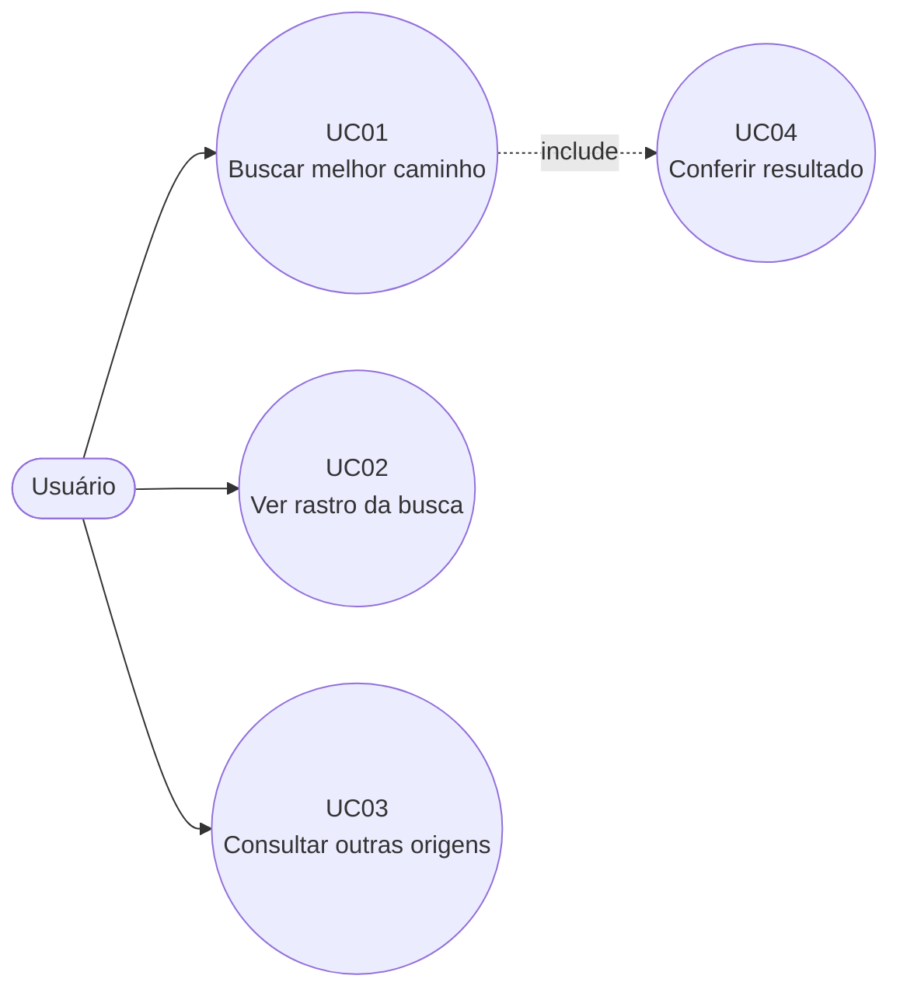

# Casos de Uso

## UC01 — Buscar melhor caminho
- **Ator:** Usuário
- **Pré-condição:** `mapa.py` carregado.
- **Fluxo principal:**
  1. Usuário executa `python a_estrela.py`.
  2. Sistema roda a busca A* de Arad a Bucharest.
  3. Sistema exibe o caminho e o custo total.
- **Fluxo alternativo:** origem ou objetivo sem caminho → sistema exibe "Não foi possível encontrar um caminho."
- **Pós-condição:** caminho ótimo (418 km, 4 passos) exibido.

## UC02 — Ver rastro da busca
- Sistema imprime, a cada iteração, o nó expandido (g, h, f) e a fronteira ordenada por f.

## UC03 — Consultar outras origens
- Sistema executa a busca com `mostrar=False` para Timisoara, Oradea, Craiova e Iasi e imprime custo e caminho.

## UC04 — Conferir resultado
- Sistema compara com o valor do livro (418 km, 4 passos) e imprime "Conferido" ou "ATENÇÃO".
