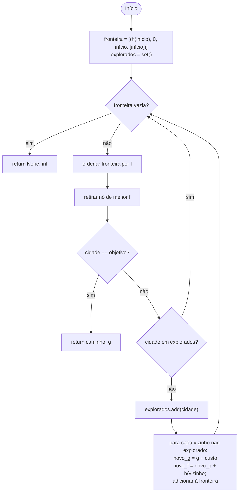
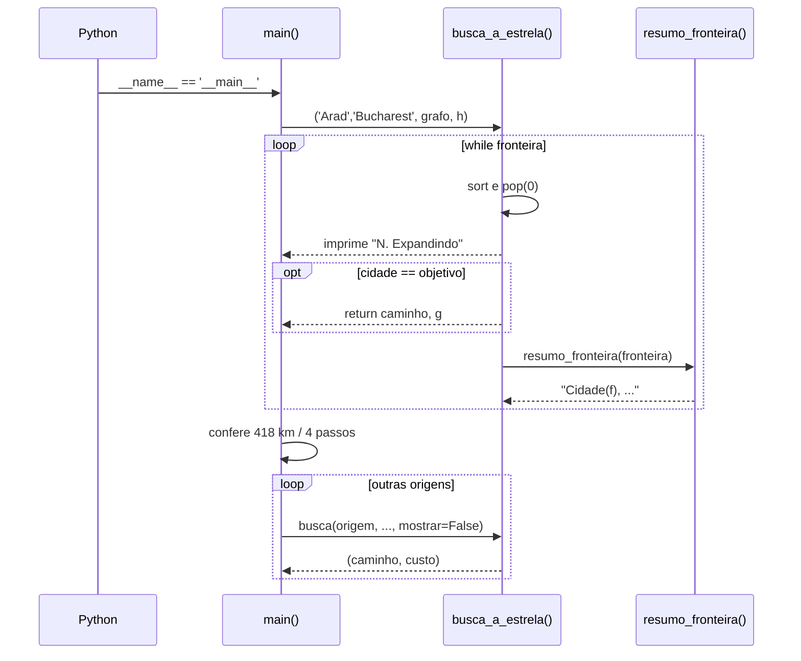
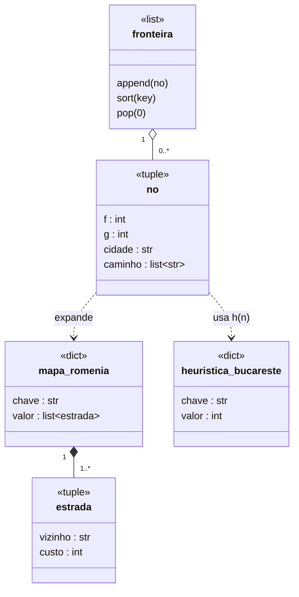
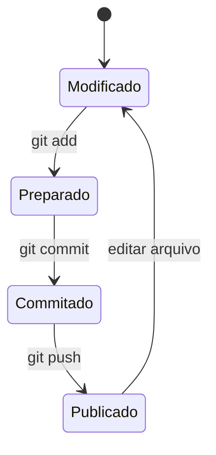
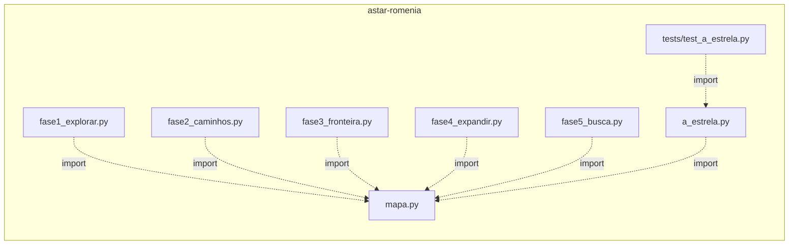
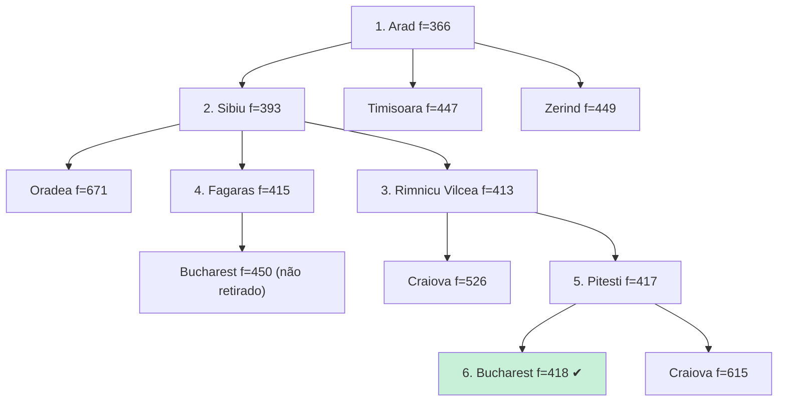

# Diagramas UML

## Atividade — algoritmo A*

## Sequência — programa completo

## Classes — estruturas de dados

## Estados — arquivo no Git

## Pacotes — arquivos do projeto

## Objetos — árvore de busca (Arad → Bucareste)

