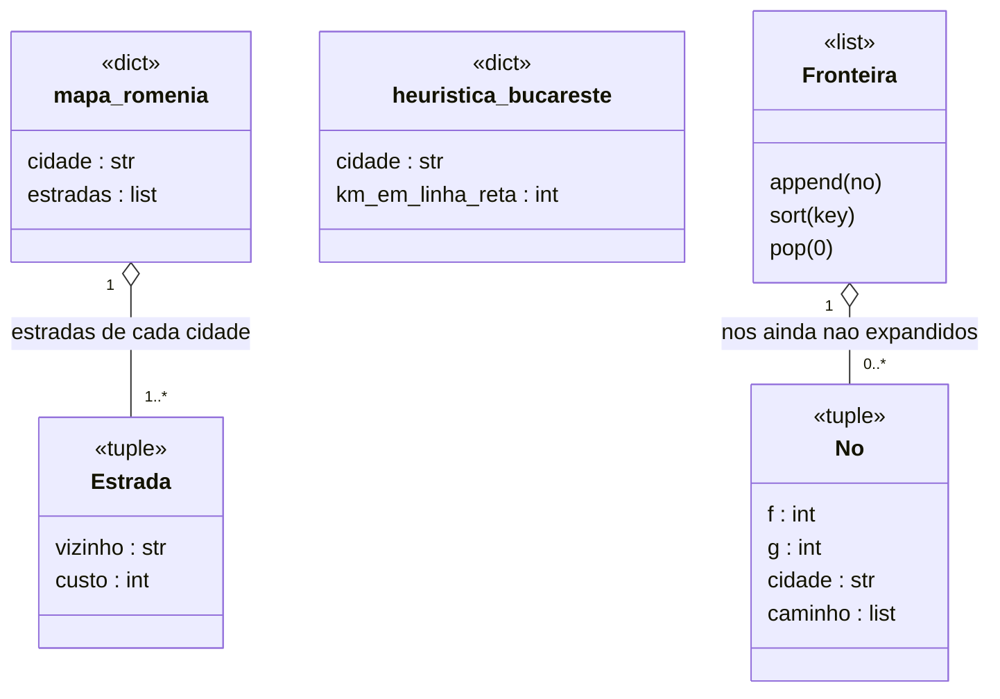
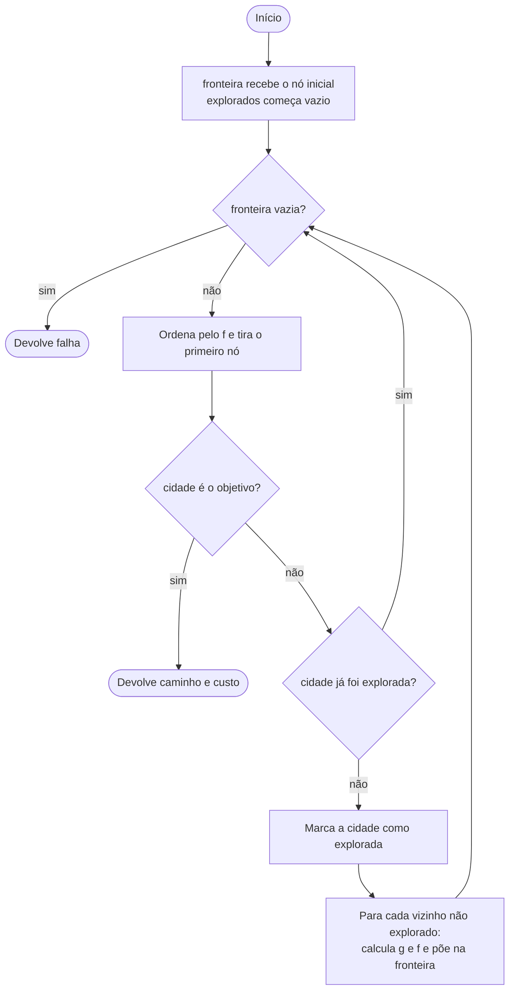
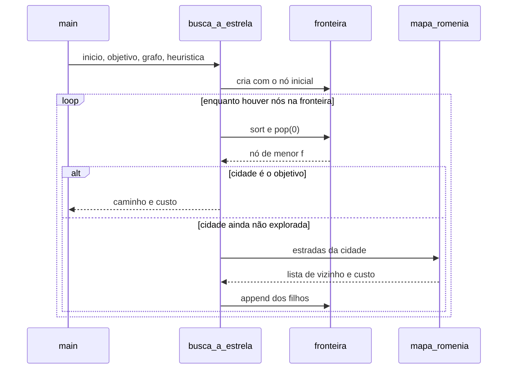
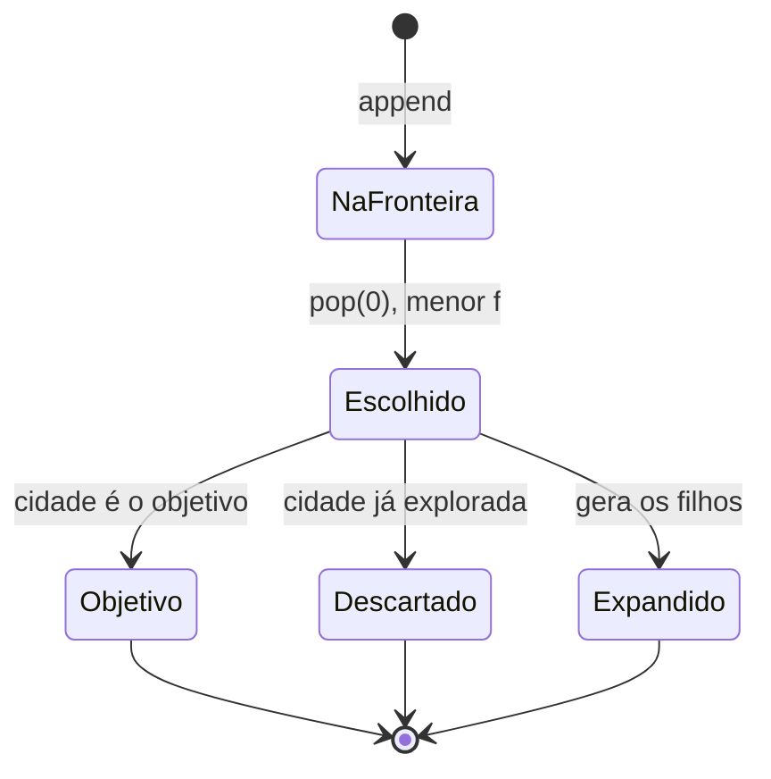
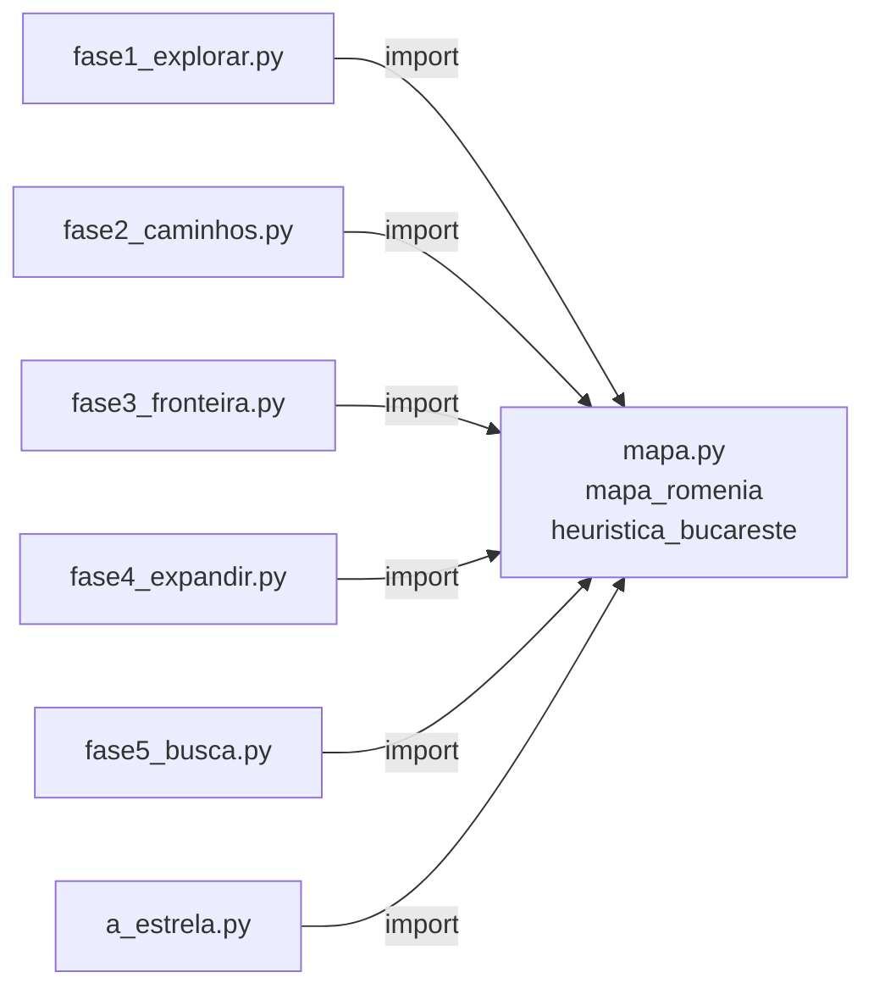

# Diagramas UML

Diagramas do projeto da busca A* (Arad até Bucareste). Estão em Mermaid, que o GitHub desenha direto na página.

## 1. Diagrama de classes

As estruturas de dados do programa. Em Python elas são dict, list e tuple, não classes de verdade, por isso o estereótipo em cada caixa.

## 2. Diagrama de atividade

O fluxo da função busca_a_estrela.

## 3. Diagrama de sequência

Quem chama quem durante a execução.

## 4. Diagrama de estados

Os estados por onde um nó passa.

## 5. Diagrama de pacotes

Como os arquivos se relacionam. Todos usam os dados de mapa.py.

